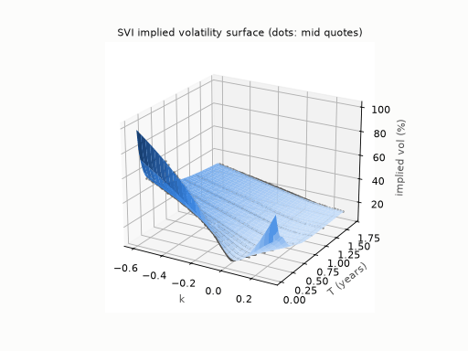

# volsurf: SPX implied volatility surface and arbitrage detection



*The GIF is rendered with matplotlib from the saved fits (`volsurf.plotting.rotating_gif`).
It alternates SVI and SSVI every quarter turn. It is not a screen recording of the app.*

This project builds an implied volatility surface from SPX option quotes and fits it
two ways: SVI one expiry at a time, and SSVI across the whole surface. It then
checks both the raw quotes and the fitted surfaces for static arbitrage. Every raw
violation is checked twice, on mid prices and on executable bid/ask prices.

**Headline (snapshot of the 2026-10-16 close, 10 expiries, 2,308 OTM quotes):**

| | SVI | SSVI |
|---|---:|---:|
| RMSE (vol points) | 0.16 | 3.00 |
| Fitted vols inside bid-ask | 80% | 9% |
| Slices with negative density (g < 0) | 5 of 10, all beyond the last quoted call | 0 |
| Adjacent expiries crossing | 6 of 9, all beyond the last quoted call | 0 |

Raw quotes: **620** violations on mid, **6** survive bid and ask, and every one of the 6
has a leg with zero open interest. See [REPORT.md](REPORT.md) for the full write-up.

## Quick start

```bash
make install
```

```bash
make collect
```

```bash
make run
```

```bash
make figures
```

```bash
make app
```

* `make collect` saves a new snapshot to `data/raw/<UTC time>/`. Raw snapshots are never overwritten.
* `make run` fits the latest snapshot and writes everything to `results/<snapshot>/`.
* `make figures` writes the PNG figures to `results/<snapshot>/figures/`.
* `make app` opens the Streamlit viewer. It only reads saved results.

Run the tests with `make test`, and re-execute the notebook with `make notebook`.
Without `make`, use `python -m volsurf collect | run | figures`, and run the app with
`streamlit run app/streamlit_app.py`.

## Pipeline

| Step | Module | What happens |
|---|---|---|
| 1 Collect | `data.collect_snapshot` | Calls and puts for 10 expiries (weeklies for the shortest target, otherwise standard monthlies), all strikes, bid/ask; saved with fetch time and estimated quote time |
| 2 Clean | `data.clean_chain` | Drop zero bids, crossed quotes, spreads > 50% of mid, options > 10% ITM; keep one of SPX (AM) / SPXW (PM) per date |
| 3 Forward and discount | `forwards.fit_forward` | Weighted regression of C − P on K near the money, robust 3-MAD second pass |
| 4 OTM selection | `quotes.build_quotes` | Puts below F, calls at or above F |
| 5 Implied vol | `pricing.implied_vol` | Black on the forward, Brent's method, bid/mid/ask vols |
| 6 Raw arbitrage | `arbitrage.raw_arbitrage` | Vertical, slope bound, strike-weighted butterfly, calendar; mid vs executable |
| 7 SVI | `svi.fit_svi` | Quasi-explicit (Zeliade) fit per expiry, weighted by inverse spread |
| 8 SSVI | `ssvi.fit_ssvi` | Power-law φ, Gatheral and Jacquier constraints enforced through the parameterisation |
| 9 Fitted arbitrage | `arbitrage.g_function`, `calendar_report` | g(k) on a fine grid, slice crossing |
| 10 Report | `pipeline.run_pipeline` | CSV/JSON/parquet results that the notebook and the app read |

## Layout

```
src/volsurf/      package: data, pricing, forwards, quotes, svi, ssvi, arbitrage, plotting, pipeline
tests/            unit and integration tests (offline; synthetic chains)
app/              Streamlit viewer (reads results only)
notebooks/        analysis.ipynb with all visuals, executed
data/raw/         raw snapshots, one folder per fetch, never overwritten
results/          pipeline outputs per snapshot, including figures/
REPORT.md         findings
```

## Tests

`pytest` runs 72 tests in under 30 seconds, with no network access. CI
(`.github/workflows/ci.yml`) follows the quant-signal-pipeline setup: on every push and
pull request to `main` it installs the package and runs `pytest tests/ -v`. It also runs
ruff, on Python 3.11, 3.12 and 3.13.

| Test file | What it proves |
|---|---|
| `test_pricing.py` | Black price → implied vol → price round trip; bounds return NaN; vega and parity identities |
| `test_forwards.py` | Forward and discount recovered exactly from synthetic parity, and robustly with noise and outliers |
| `test_svi.py` | Parameter recovery from noisy SVI data; constraints hold; density integrates to 1 and matches Breeden–Litzenberger; Vogt's arbitrage slice gets g < 0 |
| `test_arbitrage.py` | Handmade price sets with known vertical, slope, uneven butterfly and calendar violations get flagged; clean sets pass; mid-only violations don't survive bid/ask |
| `test_ssvi.py` | Recovery of known SSVI parameters; fitted parameters always satisfy the no-arbitrage conditions, even on data generated outside them; random admissible parameters give g ≥ 0 and no crossing |
| `test_data.py` | Quote-time estimate, AM/PM settlement times, monthly/holiday expiry selection, cleaning counts, raw snapshots cannot be overwritten |
| `test_pipeline.py` | End to end on a synthetic snapshot: forwards recovered, zero executable arbitrage, SSVI truth recovered |

## Data caveats

Yahoo Finance quotes are delayed about 15 minutes and have no quote timestamps or
sizes. Outside market hours they are the prior session's last quotes. "Survives bid
and ask" therefore means "survives the displayed quotes". In-the-money quotes in the
feed are often stale; see the diagnostic in the report.
